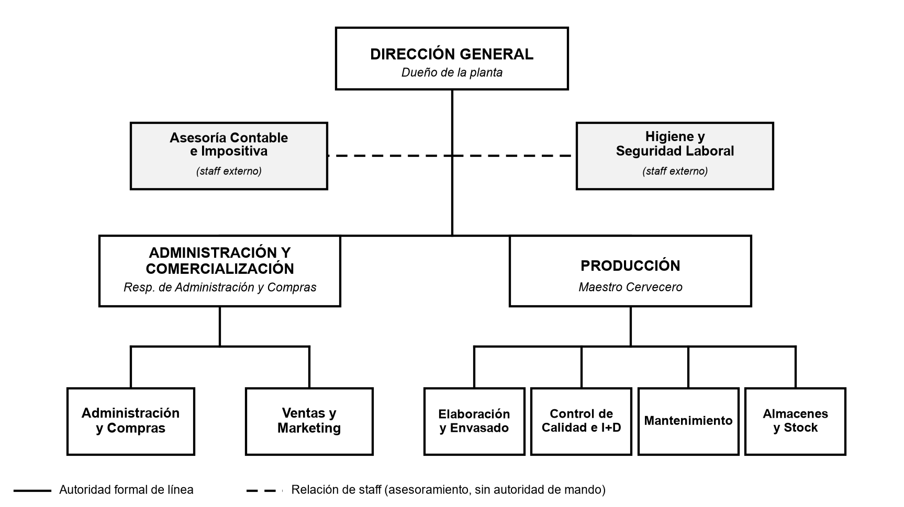

# Entrega 3 – Estructura formal y diseño de datos

## Organigrama

- Departamentalización **funcional**, estructura **lineal con staff**, **tres niveles** (estratégico, táctico, operativo).
- Dirección General → Administración y Comercialización (Administración y Compras; Ventas y Marketing) y Producción (Elaboración y Envasado; Control de Calidad e I+D; Mantenimiento; Almacenes y Stock).
- Staff externo (línea de trazos): Asesoría Contable e Impositiva; Higiene y Seguridad Laboral.
- Cuatro personas cubren las secciones por polivalencia; el organigrama muestra unidades, no personas.

## Diccionario de datos (resumen)

| Entidad | Campos principales | Responsable de carga |
|---|---|---|
| `MATERIA_PRIMA` | id_materia_prima (PK), nombre, categoria, unidad_medida, stock_actual, stock_minimo, requiere_frio, fecha_vencimiento | Compras / Almacenes |
| `EQUIPO` | id_equipo (PK), nombre, sala, criticidad, frecuencia_preventivo_dias, fecha_ultimo_mant, en_servicio | Mantenimiento |
| `LOTE_PRODUCCION` | id_lote (PK), codigo_lote, id_fermentador (FK), fecha_elaboracion, litros_producidos, temp_fermentacion, fecha_embotellado, cantidad_botellas, estado, aprobado_calidad | Elaboración / Calidad |
| `ORDEN_MANTENIMIENTO` | id_orden (PK), id_equipo (FK), tipo, fecha, descripcion, horas_parada, costo, cerrada | Mantenimiento |
| `CLIENTE` | id_cliente (PK), razon_social, cuit, tipo_cliente, localidad, telefono, activo | Ventas |
| `PEDIDO` | id_pedido (PK), id_cliente (FK), id_lote (FK), fecha_pedido, cantidad_botellas, precio_unitario, entregado | Ventas |

Relaciones: EQUIPO 1–N ORDEN_MANTENIMIENTO; EQUIPO 1–N LOTE_PRODUCCION; CLIENTE 1–N PEDIDO; LOTE_PRODUCCION 1–N PEDIDO.
