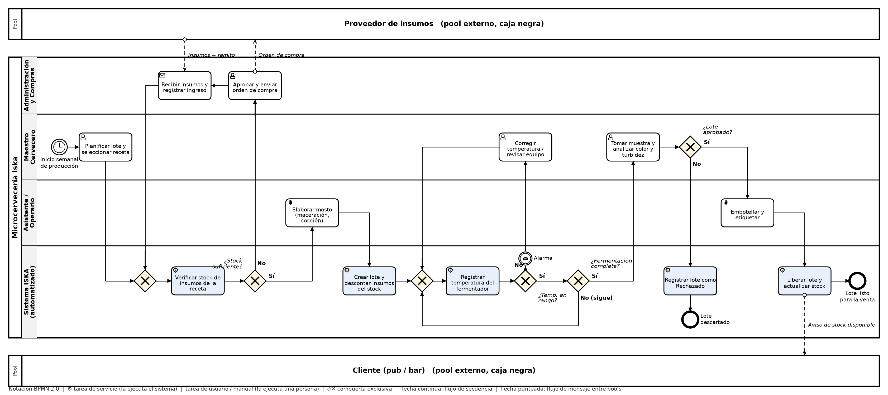

# Entrega 4 – Proceso de negocio en BPMN

**Proceso modelado:** *Elaboración, control de fermentación y liberación de un lote.*
Es el proceso central de Iska y el que el Sistema ISKA transforma: hoy el stock se controla en planillas, la temperatura se mira en el panel y se anota a mano, y la liberación del lote depende de que alguien recuerde actualizar el inventario.

El archivo [`bpmn/proceso_lote_iska.bpmn`](bpmn/proceso_lote_iska.bpmn) es BPMN 2.0 estándar y se puede abrir y editar en https://demo.bpmn.io o en Camunda Modeler.

## Pools y lanes

| Elemento | Tipo | Justificación |
|---|---|---|
| Proveedor de insumos | Pool externo (caja negra) | Organización ajena: sólo interesa el intercambio de mensajes (orden de compra ↔ insumos y remito). |
| Microcervecería Iska | Pool del proceso | Contiene el flujo que se automatiza. |
| ↳ Administración y Compras | Lane | Aprueba la compra y registra el ingreso (sección *Administración y Compras* del organigrama). |
| ↳ Maestro Cervecero | Lane | Planifica el lote, corrige desvíos y decide la aprobación de calidad (jefe de *Producción* y *Control de Calidad*). |
| ↳ Asistente / Operario | Lane | Tareas manuales de elaboración y envasado (*Elaboración y Envasado*). |
| ↳ Sistema ISKA | Lane | Comportamiento automatizado: tareas de servicio que ejecuta el software sin intervención humana. |
| Cliente (pub / bar) | Pool externo (caja negra) | Recibe el aviso de stock disponible. |

## Flujo estándar (camino feliz)

1. **Evento de inicio temporizado:** cada semana de producción.
2. El maestro cervecero **planifica el lote y elige la receta**.
3. El sistema **verifica el stock** de los insumos que exige la receta → hay stock.
4. El operario **elabora el mosto** (molienda, maceración, cocción y enfriamiento).
5. El sistema **crea el lote** (`LOTE_PRODUCCION`) y **descuenta los insumos** (`MATERIA_PRIMA`).
6. El sistema **registra la temperatura del fermentador** de forma continua.
7. Temperatura en rango y fermentación completa → el maestro **toma una muestra y analiza** color y turbidez.
8. Lote aprobado → el operario **embotella y etiqueta**.
9. El sistema **libera el lote, actualiza el stock de producto terminado** y avisa a los clientes. **Fin:** lote listo para la venta.

## Excepciones (compuertas exclusivas)

| Compuerta | Condición de excepción | Tratamiento |
|---|---|---|
| ¿Stock suficiente? | **No** | Administración aprueba y envía la orden de compra (mensaje al proveedor), recibe los insumos y registra el ingreso; el flujo vuelve a verificar stock. |
| ¿Temperatura en rango? | **No** | El sistema emite una **alarma** (evento intermedio de mensaje); el maestro corrige la temperatura o revisa el equipo y el monitoreo continúa. |
| ¿Fermentación completa? | **No** | El sistema sigue registrando (bucle de monitoreo). |
| ¿Lote aprobado? | **No** | El sistema registra el lote como *Rechazado*. **Fin:** lote descartado. |

Las compuertas sin nombre son de **unión** (merge): reciben los retornos de los bucles para que cada tarea tenga una sola entrada.

## Relación con el resto del TPI

- Cada lane corresponde a una unidad del organigrama (Entrega 3), respetando la unidad de mando.
- Las tareas de servicio leen y escriben las entidades del diccionario de datos.
- Las excepciones originan las historias de usuario del backlog y los indicadores de control.
